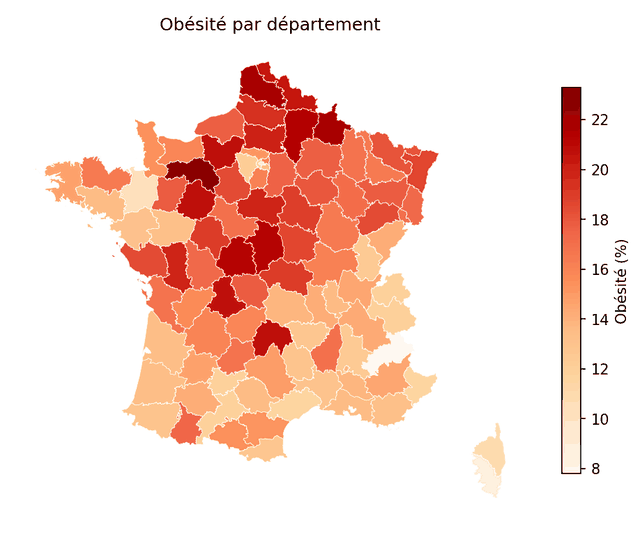

# Obésité, pauvreté et accès aux soins : une analyse par département

Projet de Python pour la data science (ENSAE, 2A, 2026).


<p align="center">
  
</p>
<p align="center"><em>Obésité, pauvreté, fast-foods et accès aux médecins, par département.</em></p>

## La question

La prévalence de l'obésité d'un territoire est-elle liée à sa pauvreté, à l'accès aux soins (déserts médicaux), à la présence de fast-foods ou à celle de salles de sport ?

Nous étudions les 96 départements de France métropolitaine, à partir de données ouvertes (DREES, INSEE, OpenStreetMap). Le rapport complet est le notebook [`notebooks/rapport.ipynb`](notebooks/rapport.ipynb).

## Résultats principaux

- **Pauvreté :** à région égale, un point de pauvreté en plus correspond à environ 0,3 point d'obésité en plus (intervalle de confiance à 95 % de 0,12 à 0,48). Ce lien disparaît si on ignore la région.
- **Fast-foods :** le lien est négatif et fragile. Il reflète sans doute le profil des territoires (grandes villes, tourisme) et non un effet protecteur.
- **Accès aux médecins, salles de sport, densité, part des 60 ans et plus :** pas de lien détectable une fois la région prise en compte.
- **Région :** elle explique à elle seule plus de la moitié des écarts d'obésité entre départements.

Ces résultats sont des associations entre départements, pas des causes (voir les limites plus bas).

## Méthode

1. Construction d'une table de 96 départements à partir de sources ouvertes (code dans `src/`).
2. Analyse descriptive : statistiques, distributions, corrélations, nuages de points.
3. Cartes par département.
4. Régressions linéaires de l'obésité sur la pauvreté, l'accès aux médecins, les fast-foods, les salles de sport, la densité et la part des 60 ans et plus, avec la région en effet fixe et des écarts-types robustes. Vérifications : colinéarité (VIF) et résultats refaits sans Paris et sans la Seine-Saint-Denis.

## Données

| Variable | Source | Année |
|---|---|---|
| Obésité | DREES, enquête EpiCov | octobre à décembre 2020 |
| Pauvreté et niveau de vie | INSEE, Filosofi | 2021 |
| Population | INSEE, estimations de population | 2021 |
| Accès aux médecins | DREES, APL | 2022 |
| Restaurants et salles de sport | INSEE, base permanente des équipements | 2025 |
| Fast-foods | OpenStreetMap | extraction du 16 novembre 2026 |
| Densité, régions, contours | geo.api.gouv.fr et france-geojson | dernières versions |

Le détail (adresses, nettoyage, limites) est dans [`data/README.md`](data/README.md).

## Limites

- Les liens sont mesurés entre départements : ils ne disent rien sur les individus (erreur écologique) et ne prouvent aucune cause.
- L'obésité vient d'une enquête, probablement déclarative, avec environ 3 points d'incertitude par département.
- Les données datent d'années différentes, de 2020 à 2026.
- OpenStreetMap est rempli par des bénévoles, et les fast-foods sont aussi comptés dans la restauration de la BPE.
- Avec 96 départements pour une vingtaine de coefficients, un effet non significatif n'est pas forcément absent.
- Les départements d'outre-mer sont exclus.

## Contenu du dépôt

```
data/
  raw/            fichiers téléchargés, tels quels
  processed/      table finale : departements.csv
  README.md       sources, nettoyage et limites
src/
  config.py       chemins du projet
  collecte.py     téléchargement des sources
  nettoyage.py    nettoyage et assemblage de la table
notebooks/
  rapport.ipynb   le rapport complet
  01_descriptif.ipynb, 02_regression.ipynb, 03_cartes.ipynb
                  les trois parties du rapport, séparément
figures/          graphiques et cartes
requirements.txt  bibliothèques et versions
```

## Installation

Il faut Python 3.10 ou plus récent, Git et VS Code avec les extensions Python et Jupyter.

```bash
git clone https://github.com/leonardlevi/projet-2A.git
cd projet-2A
```

Création de l'environnement et installation des bibliothèques :

```bash
# Windows (PowerShell)
py -3 -m venv .venv
.venv\Scripts\Activate.ps1

# macOS / Linux
python3 -m venv .venv
source .venv/bin/activate

pip install -r requirements.txt
```

## Lancer le rapport

1. Ouvrir le dossier du projet dans VS Code.
2. Ouvrir `notebooks/rapport.ipynb`.
3. Choisir comme noyau l'environnement `.venv`.
4. Cliquer sur « Tout exécuter ».

Aucun téléchargement n'est nécessaire : les données brutes sont dans `data/raw/`, et la table finale dans `data/processed/`.

## Reconstruire la table

Pour refaire la table `data/processed/departements.csv` à partir des fichiers bruts, depuis la racine du projet :

```bash
python -c "from src.nettoyage import table_finale; table_finale()"
```

Le détail des sources, du nettoyage et des limites est dans [`data/README.md`](data/README.md).

## Auteurs

Magomed Khanakaev, Alicia Hamdini et Léonard Levi.
